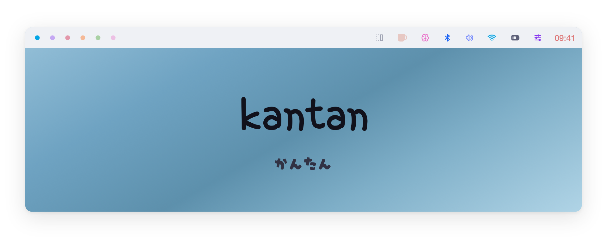

<p align="center">
  <a href="https://kantan.bar">
    <picture>
      <source media="(prefers-color-scheme: dark)" srcset="web/images/readme-dark.png">
      
    </picture>
  </a>
</p>

<p align="center"><strong>A beautifully simple status bar for macOS</strong></p>

<p align="center">
  <a href="https://kantan.bar">Website</a> ·
  <a href="https://kantan.bar/docs/">Docs</a> ·
  <a href="#install">Install</a>
</p>

- **Deeply native modules.** Battery, volume, WiFi, Bluetooth, Focus and workspaces, updating the instant something changes.
- **Plugins in any language.** A plugin reads its settings from environment variables and prints JSON.
- **Rich popups and menus.** Build them from a view DSL in your config or a plugin's output.
- **Themes with light and dark mode.** Bring your own palettes or use the bundled [Catppuccin](https://catppuccin.com).
- **Menu bar masking.** Restyle native indicators. Their menus keep working underneath.
- **Tidy by design.** Drawers, notch-aware placement and every display covered.

## Install

kantan runs on Apple silicon Macs with macOS Sequoia (15) or later.

```sh
# Homebrew
brew install cmacrae/tap/kantan

# Nix
nix run github:cmacrae/kantan

# Install script
curl -fsSL https://kantan.bar/install.sh | sh
```

Run `kantan` and a welcome bar appears. Check out the [quick start](https://kantan.bar/docs/getting-started/quick-start.html) guide.

## Learn more

The [website](https://kantan.bar) shows kantan in action, and the [docs](https://kantan.bar/docs/) cover configuration, every module, themes and writing plugins. Questions, ideas and setups to share are welcome in [Discussions](https://github.com/cmacrae/kantan/discussions).

## Contributing

See [CONTRIBUTING.md](CONTRIBUTING.md) for setting up, checking your changes and writing commit messages.

## License

kantan is released under the [MIT License](LICENSE). It bundles third-party software under their own licences, listed in [THIRD_PARTY_NOTICES](THIRD_PARTY_NOTICES).
